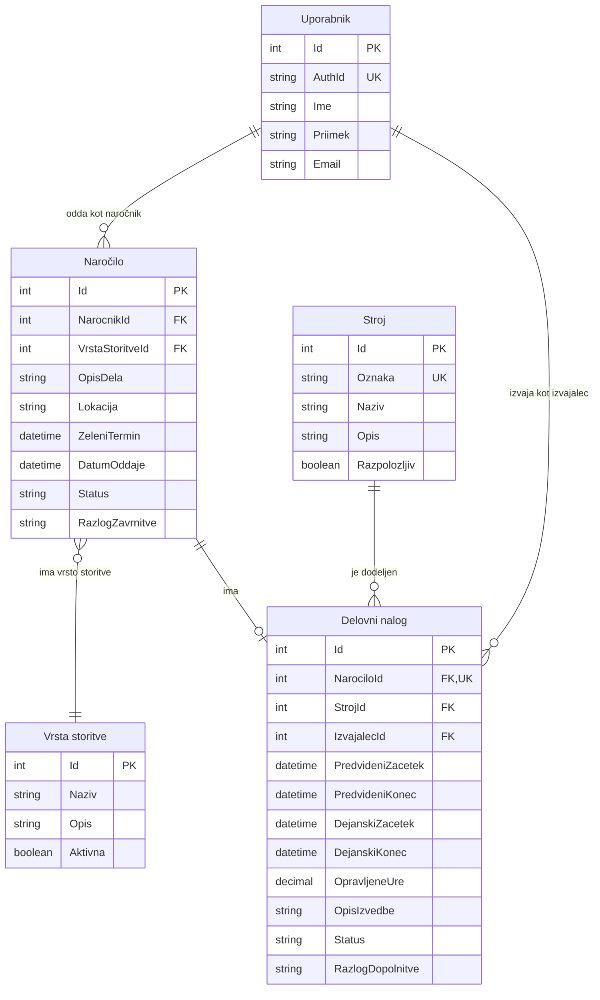

# Podatkovni model

Rešitev uporablja relacijsko bazo **PostgreSQL** s petimi povezanimi entitetami. Tipi v zasnovi so `int`, `string`, `boolean`, `datetime` in `decimal`. PK označuje primarni ključ, FK tuji ključ, UNIQUE pa enolično vrednost.

## Entitete in glavna polja

### Uporabnik

Profil naročnika, organizatorja ali izvajalca. Gesla in vloge upravlja Keycloak; `AuthId` je identifikator `sub` iz preverjenega žetona. Profil nastane ob prvi prijavi.

| Polje | Tip | Namen |
| --- | --- | --- |
| `Id` | `int` | PK. |
| `AuthId` | `string` | UNIQUE; povezava z identiteto v Keycloaku. |
| `Ime` | `string` | Ime. |
| `Priimek` | `string` | Priimek. |
| `Email` | `string` | Kontaktna e-pošta. |

### VrstaStoritve

Ponujene storitve, na primer izkop ali prevoz materiala.

| Polje | Tip | Namen |
| --- | --- | --- |
| `Id` | `int` | PK. |
| `Naziv` | `string` | Naziv storitve. |
| `Opis` | `string` | Neobvezen opis. |
| `Aktivna` | `boolean` | Na voljo za nova naročila. |

### Narocilo

Zahteva stranke za eno storitev.

| Polje | Tip | Namen |
| --- | --- | --- |
| `Id` | `int` | PK. |
| `NarocnikId` | `int` | FK → `Uporabnik.Id`. |
| `VrstaStoritveId` | `int` | FK → `VrstaStoritve.Id`. |
| `OpisDela` | `string` | Opis naročenega dela. |
| `Lokacija` | `string` | Naslov ali opis lokacije. |
| `ZeleniTermin` | `datetime` | Predlog termina. |
| `DatumOddaje` | `datetime` | Čas oddaje. |
| `Status` | `string` | `ODDANO`, `POTRJENO` ali `ZAVRNJENO`. |
| `RazlogZavrnitve` | `string` | Obvezen ob zavrnitvi, sicer prazen. |

### Stroj

Stroji podjetja za izvedbo nalogov.

| Polje | Tip | Namen |
| --- | --- | --- |
| `Id` | `int` | PK. |
| `Oznaka` | `string` | UNIQUE; interna oznaka. |
| `Naziv` | `string` | Naziv stroja. |
| `Opis` | `string` | Neobvezen opis. |
| `Razpolozljiv` | `boolean` | Splošna dostopnost; terminsko zasedenost določajo nalogi. |

### DelovniNalog

Razpored in evidenca izvedbe potrjenega naročila.

| Polje | Tip | Namen |
| --- | --- | --- |
| `Id` | `int` | PK. |
| `NarociloId` | `int` | FK → `Narocilo.Id`, UNIQUE. |
| `StrojId` | `int` | FK → `Stroj.Id`. |
| `IzvajalecId` | `int` | FK → `Uporabnik.Id`. |
| `PredvideniZacetek` | `datetime` | Načrtovani začetek. |
| `PredvideniKonec` | `datetime` | Načrtovani konec. |
| `DejanskiZacetek` | `datetime` | Čas začetka dela. |
| `DejanskiKonec` | `datetime` | Čas zaključka dela. |
| `OpravljeneUre` | `decimal` | Dejanske ure, ki jih vnese izvajalec. |
| `OpisIzvedbe` | `string` | Opis opravljenega dela. |
| `Status` | `string` | Stanje naloga, opisano spodaj. |
| `RazlogDopolnitve` | `string` | Obvezen ob vrnitvi v dopolnitev. |

Dejanski časi, ure in opis izvedbe so do izvedbe lahko prazni.

## Povezave in osnutek modela

Naročnik lahko odda več naročil. Vsako naročilo ima eno vrsto storitve in največ en nalog. Stroj in izvajalec se lahko pojavita na več nalogih v različnih terminih.

| Oznaka | Kardinalnost | Pomen |
| --- | --- | --- |
| `\|\|` | `1..1` | Natanko en zapis. |
| `o\|` | `0..1` | Nič ali en zapis. |
| `o{` | `0..N` | Nič ali več zapisov. |

PK = primarni ključ, FK = tuji ključ, UK = enolična vrednost. Oznaka ob entiteti pove, koliko njenih zapisov pripada enemu zapisu na drugi strani povezave.

## Ključna pravila

- Nalog nastane samo za potrjeno naročilo; UNIQUE na `NarociloId` zagotavlja največ en nalog.
- `NarocnikId` kaže na naročnika, `IzvajalecId` pa na uporabnika z vlogo izvajalca.
- Predvideni konec mora biti po začetku; termina istega stroja ali izvajalca se ne smeta prekrivati. Zaporedna termina sta dovoljena.
- Potek naloga: `NACRTOVAN` → `V_IZVAJANJU` → `CAKA_NA_PREGLED` → `ZAKLJUCEN`.
- Organizator lahko iz `CAKA_NA_PREGLED` vrne nalog v `V_DOPOLNITVI`; izvajalec dopolni evidenco in jo znova odda v pregled.
- Za pregled so obvezni dejanski časi, pozitivno število ur in opis izvedbe. Dejanski konec ne sme biti pred začetkom.
- Napredek naročila se prikaže iz povezanega naloga; stanje izvedbe se ne podvaja.
