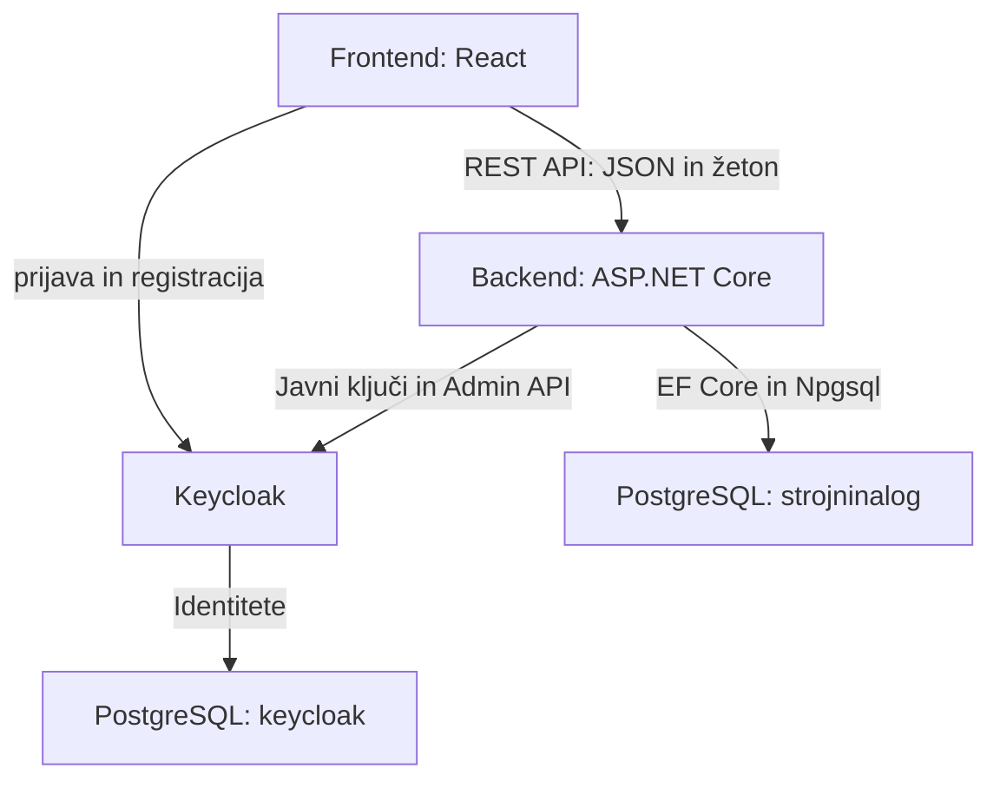

# Arhitektura in tehnološki sklad

## Arhitektura

| Del sistema | Odgovornost |
| --- | --- |
| **Frontend** | React aplikacija v brskalniku; obrazci, prikaz naročil in nalogov ter navigacija glede na vlogo. |
| **Backend** | En ASP.NET Core Web API; poslovna pravila, preverjanje pravic in shranjevanje podatkov. |
| **PostgreSQL** | Baza `strojninalog` za pet poslovnih entitet ter ločena baza `keycloak` za identitete. |
| **Keycloak** | Registracija, prijava, uporabniški računi in vloge. |

Frontend kliče REST API z JSON podatki in dostopnim žetonom v glavi `Authorization: Bearer <token>`. Backend dostopa do poslovne baze prek EF Core in Npgsql, do Keycloaka pa prek uradnih vmesnikov. Vsaka baza ima ločenega uporabnika in pravice.

## Tehnološki sklad

| Področje | Tehnologije in orodja |
| --- | --- |
| Frontend | React, TypeScript, Vite, React Router, CSS, `fetch`. |
| Backend | C#, ASP.NET Core Web API, .NET 10 LTS. |
| Podatkovni dostop | Entity Framework Core 10, Npgsql. |
| Podatkovna baza | PostgreSQL. |
| Avtentikacija | Keycloak, OpenID Connect, `keycloak-js`, JWT Bearer preverjanje v ASP.NET Core. |
| Lokalni razvoj | Docker Compose; Node.js LTS, npm in .NET SDK za razvoj zunaj vsebnikov. |
| Druga orodja | Git, DataGrip, VS Code in OpenAPI za opis API-ja. |

## Avtentikacija in uporabniki

- Keycloak uporablja realm `strojninalog` in vloge `narocnik`, `organizator`, `izvajalec`. Vsak račun ima eno aplikacijsko vlogo.
- Naročnik se registrira sam in prejme samo vlogo `narocnik`. Račune zaposlenih in njihove vloge pripravi tehnični skrbnik; ta ni četrta poslovna vloga.
- Prijava poteka prek Keycloaka z Authorization Code Flow in PKCE. Frontend uporablja `keycloak-js` in žetone hrani v pomnilniku.
- Backend preveri podpis, veljavnost, izdajatelja in audience žetona ter vlogo in dostop do konkretnega zapisa. Naročnik vidi svoja naročila, izvajalec svoje naloge.
- Profil `Uporabnik` nastane ob prvi prijavi in se poveže s Keycloak identiteto prek `AuthId`. Izvajalci se prijavijo pred prvo dodelitvijo naloga.
- Vlogo dodeljenega izvajalca backend preverja prek Keycloak Admin API-ja s servisnim računom z omejenimi bralnimi pravicami. Gesla in vloge ostanejo v Keycloaku.

## Lokalni razvoj

Predviden je `docker-compose.yml` s storitvami `frontend`, `backend`, `postgres` in `keycloak`.

1. Razvijalec pripravi `.env` iz `.env.example` z lokalnimi nastavitvami in skrivnostmi.
2. Zažene `docker compose up --build`.
3. Začetna priprava ustvari bazi, izvede EF Core migracije, doda storitve in stroje ter uvozi Keycloak konfiguracijo z vlogami in odjemalci. Skrbnik pripravi račune zaposlenih.

| Del | Lokalni naslov |
| --- | --- |
| Frontend | `http://localhost:5173` |
| Backend | `http://localhost:5000` |
| Keycloak | `http://localhost:8080` |
| PostgreSQL | `localhost:5432` |

Podatki se ohranijo v Docker volumnu. Skrivnosti niso v Gitu. Med vsebniki se uporabljajo imena storitev, za brskalnik pa lokalni naslovi; izdajatelj žetonov ostane enoten. HTTP je namenjen lokalnemu razvoju, javna postavitev uporablja HTTPS in omejen CORS.

## Arhitekturne odločitve

| Odločitev | Utemeljitev |
| --- | --- |
| React + TypeScript + Vite | React omogoča interaktivne obrazce in prikaz podatkov, TypeScript preverjanje tipov, Vite pa preprost razvoj in gradnjo aplikacije. |
| ASP.NET Core backend | Poslovna pravila in preverjanje pravic so zbrani na enem mestu. |
| PostgreSQL in EF Core | PostgreSQL hrani povezane podatke in z izključitvenimi omejitvami preprečuje prekrivanje terminov; EF Core poenostavi dostop in spremembe baze. |
| Keycloak | Upravlja prijavo, registracijo, gesla in uporabniške vloge. |
| Ločeni bazi | Poslovni podatki so ločeni od podatkov, ki jih upravlja Keycloak. |
| Docker Compose | Omogoča enoten lokalni zagon aplikacije, baze in Keycloaka. |

Zasnova omogoča dodajanje novih funkcionalnosti brez spremembe osnovne arhitekture.
