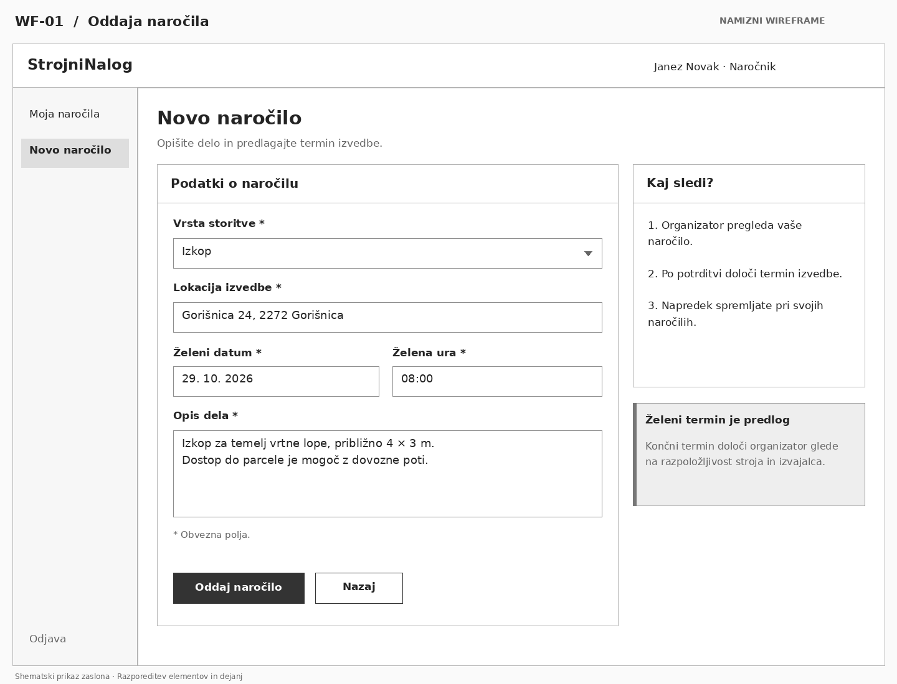
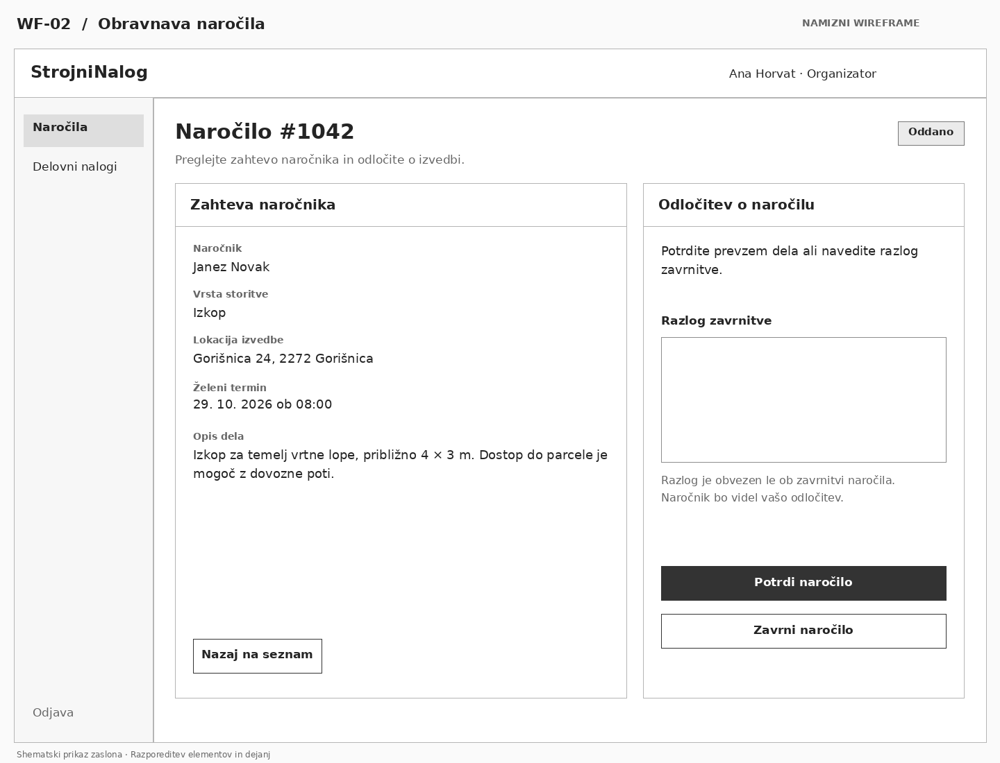
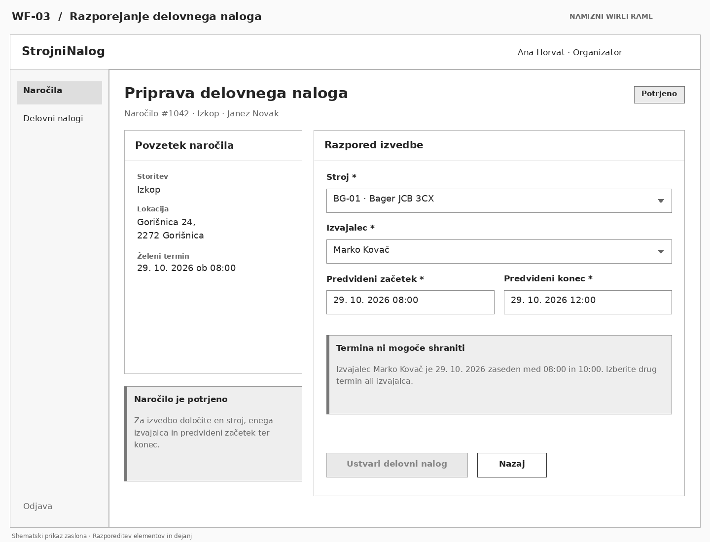
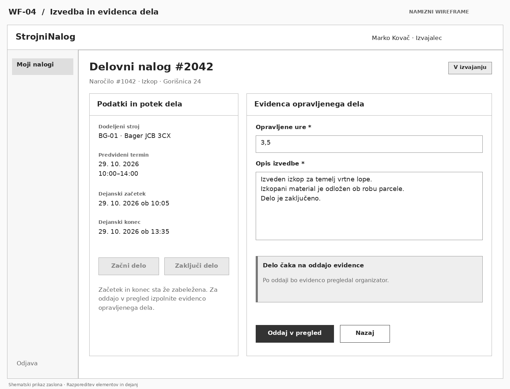
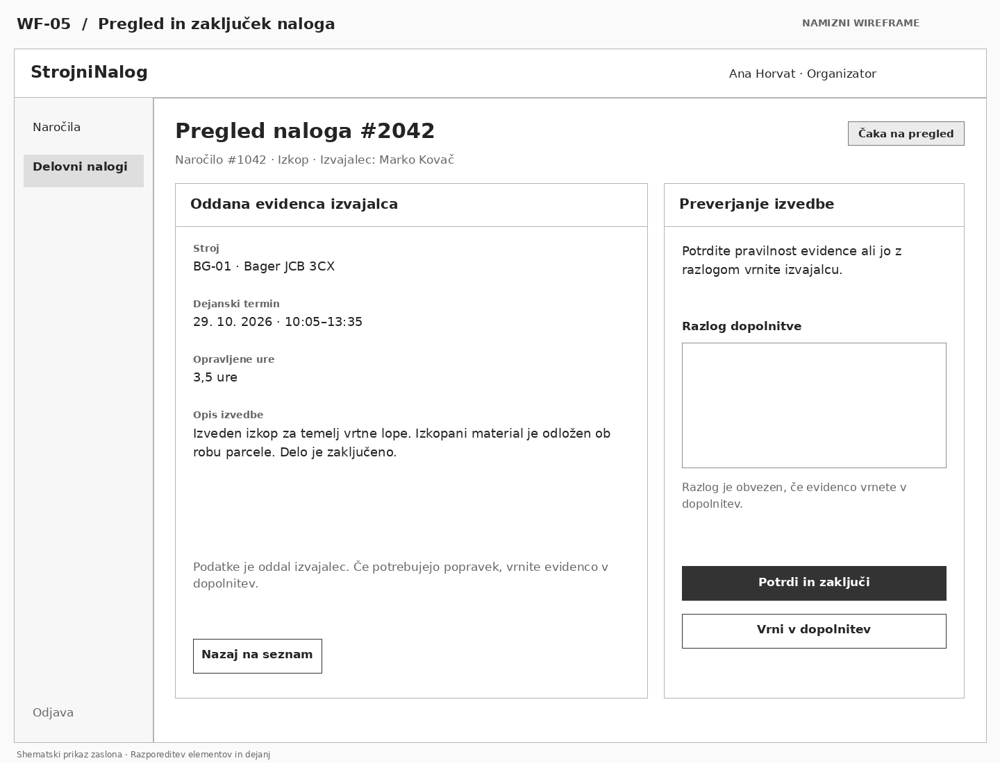

# Wireframes – StrojniNalog

Pet wireframe-ov prikazuje osnovno razporeditev zaslonov za vse tri uporabniške vloge in funkcionalnosti MVP (US-01–US-07). Primer sledi istemu naročilu od oddaje do pregleda izvedbe.

## WF-01: Oddaja naročila

**Vloga:** Naročnik · **Uporabniška zgodba:** US-01

Naročnik izbere storitev ter vnese lokacijo, želeni termin in opis dela. Z gumbom **Oddaj naročilo** pošlje naročilo organizatorju. Želeni termin je predlog; končni termin določi organizator.

## WF-02: Obravnava naročila

**Vloga:** Organizator · **Uporabniška zgodba:** US-02

Organizator pregleda podatke oddanega naročila in ga potrdi ali zavrne. Ob zavrnitvi mora vnesti razlog, ki ga vidi tudi naročnik.

## WF-03: Razporejanje delovnega naloga

**Vloga:** Organizator · **Uporabniški zgodbi:** US-03, US-04

Za potrjeno naročilo organizator določi stroj, izvajalca ter predvideni začetek in konec. Prikazan je primer prekrivanja izvajalčevih terminov: aplikacija pojasni težavo in onemogoči ustvarjanje naloga, dokler organizator ne spremeni izbire.

## WF-04: Izvedba in evidenca dela

**Vloga:** Izvajalec · **Uporabniški zgodbi:** US-05, US-06

Izvajalec vidi dodeljeni nalog, beleži začetek in konec ter vnese opravljene ure in opis izvedbe. Prikazano je stanje po koncu dela, pred oddajo evidence v pregled. Začetek in konec sta že zabeležena, zato sta gumba onemogočena. Po odpravi prekrivanja iz WF-03 je nalog načrtovan med 10.00 in 14.00.

## WF-05: Pregled in zaključek naloga

**Vloga:** Organizator · **Uporabniška zgodba:** US-07

Organizator pregleda oddano evidenco ter nalog potrdi in zaključi ali ga vrne izvajalcu v dopolnitev. Ob vrnitvi je razlog obvezen. Podatki izvajalca so prikazani samo za branje.

